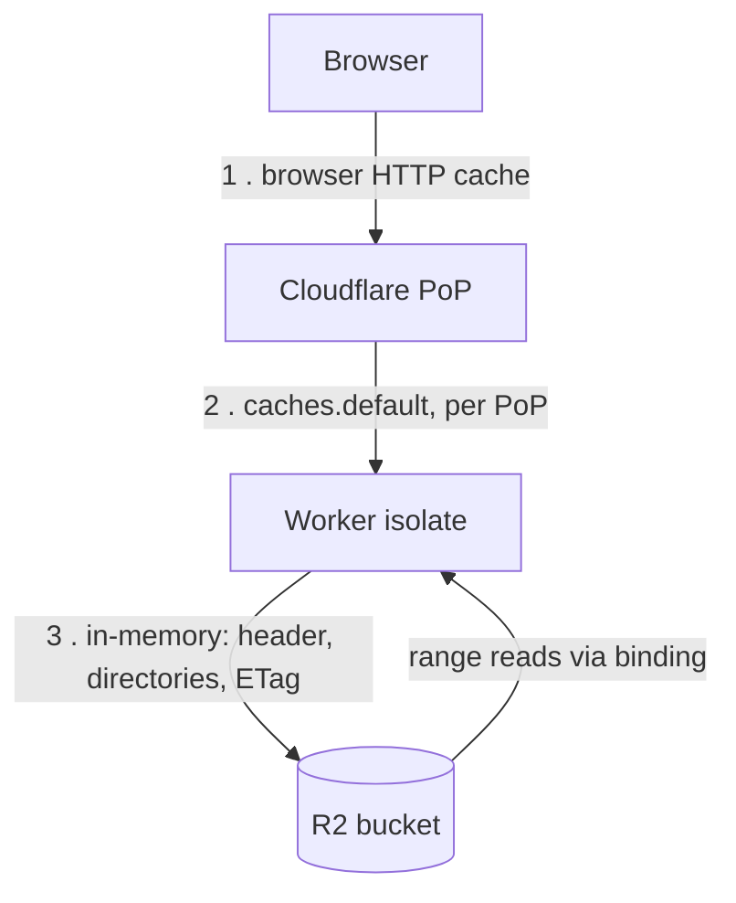

# Caching

How a tile request is cached on its way from R2 to a browser, what each layer
does, and which parts of this are verified versus assumed.

The short version: the PMTiles archives are 1.2–4.8 GB, which is far too large
for Cloudflare to cache. Serving them directly meant every request travelled the
full distance to R2. The fix is a Worker that opens the archive server-side and
returns one small, individually cacheable response per tile, at a URL that
changes whenever the archive does.

---

## Terminology

You can skip this if the words are already familiar, but the rest of the document
leans on them heavily.

### ETag

An **ETag** ("entity tag") is a short string a server attaches to a response to
identify *this exact version of this exact resource*. It's opaque — the client
never interprets it, only compares it for equality.

```http
ETag: "d41d8cd98f00b204e9800998ecf8427e"
```

Its normal job is to save bandwidth. A browser that already has a copy can ask
"has this changed since the version tagged X?" and get back a tiny `304 Not
Modified` instead of the whole body.

What matters for us is a property of how **R2 computes** them: R2 derives the
ETag from the object's *contents*. For an object uploaded in one shot it's the
MD5 hash of the bytes. For a multipart upload — which anything over a few
hundred megabytes will be — it's the MD5 of the concatenated part MD5s, followed
by a dash and the part count:

```
a3f1c9e40b7d2856f0918ab3cd4e7f21-72
```

So the ETag is *already a content hash*. We don't have to compute or track a
version ourselves: re-upload an archive, and its ETag changes. That single fact
is what the whole versioning scheme rests on.

Note the two forms in the Workers API: `R2Object.etag` is the bare value,
`R2Object.httpEtag` is the same thing wrapped in quotes for use in a header.

### Fresh, stale, and revalidation

A cached response is **fresh** for a period set by the server. While fresh, a
cache serves it with no network contact at all.

When that period expires the response becomes **stale**. Stale does *not* mean
deleted — the bytes are still there. It means the cache won't serve them without
checking first. That check is a **conditional request**: the cache re-requests
the resource with an `If-None-Match: "<etag>"` header, meaning "only send a body
if it differs from this version." The server replies either `200` with fresh
content, or `304 Not Modified` with no body at all, which tells the cache to keep
what it has and reset the freshness clock.

**Revalidation** is that round trip. It's cheap, but it's still a round trip.

### Cache-Control

The header that sets all of the above. The pieces we use:

| Directive | Meaning |
|---|---|
| `public` | Any cache may store this, including shared ones like a CDN. |
| `max-age=N` | Fresh for N seconds. |
| `immutable` | Never revalidate while fresh — *even if the user hits reload*. |
| `stale-while-revalidate=N` | Once stale, serve the old copy immediately for N more seconds while fetching a replacement in the background. |
| `s-maxage=N` | Overrides `max-age`, but only for shared caches. Not currently used here. |

`max-age` is always a **ceiling, not a guarantee**. Caches are finite and evict
under pressure, so a response can vanish long before it expires. You can rely on
"at most this long," never "at least this long."

`immutable` is the interesting one. Normally a browser refresh forces
revalidation of everything on the page regardless of `max-age`. `immutable`
suppresses that. It's only honest when the URL genuinely cannot change meaning —
which is what the version segment buys us.

### Age

When a shared cache serves something it has been holding, it adds an `Age`
header saying how many seconds it has had it. Downstream caches subtract that
from `max-age`. A tile with `max-age=31536000` that sat at the edge for a month
arrives at the browser with about eleven months of freshness left, not twelve.
The budget is shared across the whole chain, not restarted at each hop.

### Cache key

What a cache uses to decide whether two requests are "the same request." By
default it's essentially the URL. **This is the crux of the original bug:** the
cache key does *not* include the `Range` header, so two requests for different
byte ranges of the same file look identical to the cache.

### Content-addressed URL

A URL whose path contains a hash of the content it returns. Because the content
can't change without the URL changing, such a URL can be cached forever. Updating
means publishing at a *new* URL rather than invalidating the old one — the
difference between "everyone must forget what they know" and "everyone naturally
starts asking for something else."

### Range request

An HTTP request for part of a file:

```http
Range: bytes=0-16383
```

The server answers `206 Partial Content` with just those bytes. This is how the
PMTiles format is designed to be read over a network — seek to the header, seek
to a directory, seek to the tile — without downloading the archive.

### PoP / colo

Cloudflare's edge locations. A **PoP** (point of presence), also called a
**colo** (colocation facility), is one physical data centre. There are hundreds
worldwide, and each maintains its own cache storage.

### Isolate

The lightweight sandbox a Worker runs in — a V8 isolate, much cheaper than a
container. Cloudflare spins up many of them, per PoP, and discards them freely.
Any state a Worker holds in a module-level variable lives only in *one* isolate,
is not shared with others, and disappears when that isolate is recycled. This
matters below.

---

## The four layers



### Layer 1 — The browser cache

Per user, on their disk. Governed entirely by the `Cache-Control` we send.

| Response | What we send | Why |
|---|---|---|
| Tile at the current version | `public, max-age=31536000, immutable` | URL is content-addressed; it can never mean anything else. |
| Tile at a superseded/absent version | `public, max-age=60, stale-while-revalidate=300` | URL no longer describes its bytes — see below. |
| TileJSON | `public, max-age=300, stale-while-revalidate=3600` | The one document that must change. |

### Layer 2 — The Cloudflare edge

Two distinct things share this layer, and conflating them causes confusion.

**The automatic CDN cache** is what Cloudflare does on its own for ordinary
origin traffic. *We are not using it.* Responses a Worker builds itself are not
automatically cached by Cloudflare — see Assumption 3.

**The Cache API** (`caches.default`) is edge storage the Worker writes to
explicitly. `handleTile` calls `cache.match()` on the way in and `cache.put()` on
the way out (`worker/src/index.ts:324`, `:378`). Entries respect the
`Cache-Control` on the stored response, so the table above governs the edge too.

Two consequences:

- **TileJSON is never written here.** `handleTileJson` doesn't call `cache.put`.
  That's deliberate — TileJSON is the mechanism by which a redeploy reaches
  clients, so it should stay as close to R2 as possible.
- **Cache API storage is per-PoP.** A tile warmed in Sydney is a miss in Perth.
  R2 read volume scales with (unique tiles × PoPs receiving traffic), not unique
  tiles.
- **Edge caching works on `*.workers.dev`.** Older Cloudflare guidance said the
  Cache API was a no-op there; that is not what this worker observes. Against
  the dev deployment `X-Tile-Cache` goes `miss` then `hit`, with
  `CF-Cache-Status: HIT` and a rising `Age` from Cloudflare's own CDN layer.
  Dev therefore exercises both cache layers, not just the archive reads.

### Layer 3 — Worker isolate memory

Two module-level caches, both per-isolate and both ephemeral:

| Structure | Holds | Lifetime |
|---|---|---|
| `pmtilesCache` (`ResolvedValueCache`, 200 entries) | Archive header + directory pages | LRU eviction |
| `archiveEtags` | Current ETag per archive | `ARCHIVE_TTL_SECONDS` (60s) |

`pmtilesCache` is what makes this efficient. A PMTiles lookup needs the header,
then a root directory, then possibly a leaf directory, then the tile itself —
three or four reads cold. Once the directories are memoised, a tile costs a
single R2 read.

`archiveEtags` avoids a HEAD request against R2 on every single tile. It's also
the source of the subtlety in the next section.

### Layer 4 — R2

The archives themselves. The Worker reads them through its **R2 binding**
(`env.BUCKET.get(key, { range })`), not over HTTP. This means no S3 signing, no
public bucket, and — importantly — the read does not pass through Cloudflare's
CDN cache at all. Range semantics here are a storage API call, not an HTTP
negotiation, so the pathologies that affected the old setup cannot occur.

---

## Why the old design failed

Clients used to point at the raw archives with `pmtiles://`, so MapLibre issued
Range requests directly against R2 through the CDN. Two things went wrong.

**Nothing was cacheable.** Cloudflare will not cache an object above roughly
512 MB on non-Enterprise plans. All three archives exceed that, terrain and
contours by about tenfold. They were never *eligible* for the edge cache, so
every Range request travelled to R2. No amount of header tuning would have
changed that.

**Range requests aren't distinguished by the cache key.** Two requests for
different byte offsets of the same URL are the same request as far as the cache
is concerned. Combined with a cache fill strategy that fetches the *whole* object
to satisfy a partial request, this produced the occasional full-archive
response — a multi-gigabyte download aimed at a browser.

The fix isn't better control over range caching. It's to stop asking the edge to
cache a 4.8 GB object at all, and instead ask it to cache millions of 5–100 KB
tiles, each with its own URL.

---

## Versioning and redeploys

Tile URLs carry a version — the first 10 characters of the archive's R2 ETag:

```
/squiggly.v1.base/f1c266e469/8/234/151.mvt
                  ^^^^^^^^^^
```

TileJSON at `/{archive}.json` hands out the current version and is the only
document clients refetch. A redeploy therefore propagates by clients being
*handed a different URL*, not by anything being purged.

Putting the version in the URL rather than only in the edge cache key is the
whole point. An ETag folded into the edge key alone would fix the edge and leave
every browser serving whatever it had cached under a stable URL until `max-age`
expired. Content-addressed URLs fix both at once.

### What happens to a client mid-redeploy

MapLibre resolves a source's TileJSON **once**, at style load. It does not poll
it and does not refetch on a failed tile. So a map that's already open keeps
requesting the version it started with until the page is reloaded.

```
t=0    Alice loads the map. TileJSON → version f1c266e469.
t=2m   ./scripts/upload-tiles.sh replaces the object. New version a91b3c7d02.
       The old bytes are gone — there is only ever one object per archive.
t=3m   Alice pans. Her map requests .../f1c266e469/8/234/151.mvt
```

404ing that request would punch permanent holes in her map — nothing would prompt
MapLibre to re-read TileJSON, so it would stay broken until she reloaded. Instead
the Worker serves the tile from the current archive, and downgrades the cache
lifetime to 60 seconds because the URL no longer describes its bytes.

This is safe in a way the original bug was not. The old failure mixed bytes
*within a single archive read* — a directory offset from one version spliced onto
tile data from another — producing corrupt output. Here each response is a
complete, valid tile from one consistent archive. Alice's viewport just has
slightly fresher data on one side.

### The stale-isolate hazard

`archiveEtags` memoises for 60 seconds, so for up to a minute after a re-upload
an isolate still believes the old ETag is current. Meanwhile every read is
guarded by `onlyIf: { etagMatches }`; when the object has changed the guard
fails, pmtiles catches the resulting `EtagMismatch`, invalidates its directory
cache, and transparently re-reads the **new** archive.

The trap: an isolate in that window would judge a request at the *old* version to
be "current" and stamp it `immutable`, while serving *new* bytes — pinning the
mismatch for a year in browsers and at every PoP that saw it.

So cache lifetime is decided from `R2Source.lastEtag` — the ETag of the read that
actually produced the bytes — never from the memoised value
(`worker/src/index.ts:83`, `:351`). If nothing was read from R2 at all (warm
directories, absent tile), it can't be confirmed and gets the short TTL.

---

## Assumptions

Flagged because they're about Cloudflare and R2 behaviour we don't control, and
because some are inferred rather than measured.

**1. Cloudflare will not cache objects above ~512 MB** (5 GB on Enterprise).
*Confidence: high — documented behaviour.* This is the primary justification for
the Worker. It should be re-checked if the plan changes, though the design is
better regardless of limits.

**2. R2 ETags are S3-compatible content hashes.**
*Confidence: high for the property we need, medium for the exact format.* We rely
only on **ETag changes if and only if the object changes** — not on the specific
algorithm. One consequence of the multipart format: the ETag depends on chunk
size as well as content, so re-uploading identical bytes with a different
`--s3-chunk-size` yields a new version code. That costs a cache refill, nothing
worse. `upload-tiles.sh` pins 64M.

**3. Worker-synthesized responses are not automatically edge-cached.**
*Confidence: medium-high.* Only `cache.put()` puts anything at the edge. If this
is wrong, TileJSON could be cached longer than intended and redeploys would
propagate more slowly — the observable symptom would be `Age` headers appearing
on TileJSON responses. Related: **do not** add a Cloudflare Cache Rule matching
`/*.json` on this route; it would undermine the propagation mechanism.

**4. The Cache API is per-PoP with no global tier.**
*Confidence: high.* Tiered Cache and Cache Reserve apply to `fetch()` subrequests
against an origin, not to Cache API writes. Consequence is duplicated R2 reads
across PoPs — acceptable for Australia-centric traffic.

**5. Cloudflare may fill a Range miss by fetching the whole object.**
*Confidence: low — inferred from the observed symptom, not measured.* This is our
best explanation for the occasional full-archive responses under the old setup.
The Worker makes it moot either way, since browsers no longer issue Range
requests at all.

**6. R2 binding reads bypass the CDN cache and incur no egress charge.**
*Confidence: high.* Worker↔R2 traffic within Cloudflare's network is billed as
operations, not bandwidth.

### Verified in this repo

Confirmed by running the Worker against a local R2 emulation:

- TileJSON emits a versioned tile template; the version tracks the archive ETag.
- A tile at the current version returns `immutable`; a wrong or absent version
  returns `max-age=60`.
- Repeat requests report `X-Tile-Cache: hit`.
- Tile bytes are served uncompressed (see SERVING.md → Compression); absent
  tiles return `204`.
- Swapping the object underneath a warm isolate and immediately requesting the
  old version returns `max-age=60`, not `immutable` — the stale-isolate fix.

---

## Hazard: a bad deploy pins itself for a year

`immutable, max-age=31536000` is only safe while the bytes under a version URL
are correct. If a deploy serves *wrong* bytes — the `Content-Encoding` bug in
SERVING.md did exactly this — every tile requested during that window is cached
at the edge, and in browsers, under a URL that will not change until the archive
is re-uploaded and its ETag moves. Fixing the code does not evict them.

There is no cheap purge for this. `caches.default` has no zone-wide purge on a
`*.workers.dev` hostname, and the version segment is derived from the archive
ETag rather than from anything deploy-time, so a code fix alone cannot mint new
URLs. Options, in order of cost:

1. **Accept it in dev.** Only tiles actually requested during the bad window are
   poisoned, and dev is disposable.
2. **Re-upload the archive.** Changes the ETag, hence every version code, hence
   every URL. Heavy — gigabytes — but total.
3. **Add a cache-key salt.** An env var folded into the `cache.put` key would let
   a bad deploy be invalidated by bumping a string. Not implemented; the obvious
   escape hatch if this ever bites in production.

The practical mitigation is the one already in place: `--local` and `dev` both
run the full test suite and can be exercised before anything reaches the
production hostname. Verify tile *bytes*, not just status codes — a 200 with the
wrong encoding is exactly the failure that pins itself.

## Debugging

Every tile response carries `X-Tile-Cache: hit|miss` and `X-Tile-Version`.

```bash
curl -sD- -o/dev/null https://maps.tweed.nz/squiggly.v1.base/<version>/8/234/151.mvt \
  | grep -iE 'cache-control|etag|age|x-tile'
```

- `X-Tile-Cache: miss` on a repeat request → the edge cache isn't retaining it.
  Check the response isn't oversized and that `Cache-Control` is `public`.
- `X-Tile-Version` differing from the version in the URL → you're mid-redeploy,
  or a client is holding stale TileJSON. Expected; should resolve within minutes.
- An `Age` header on TileJSON → something is edge-caching it that shouldn't be.
  See Assumption 3.

## Open questions

- **TileJSON's `stale-while-revalidate=3600`** means a returning visitor whose
  cached copy is 5–65 minutes old gets the stale version code on page load, and
  runs that whole session on the short-TTL path. Not broken, but it makes
  "redeploys propagate in minutes" true only for cold visitors. Dropping the SWR
  would tighten it at the cost of one small fetch per map load.
- **Per-PoP cold starts after a redeploy.** Each redeploy starts an archive's
  edge cache from empty, so early users pay R2 latency while it refills. Modest
  for the base map, more noticeable for the 4.8 GB terrain archive if it's
  redeployed often. Per-archive ETags mean a terrain rebuild doesn't disturb the
  base map's cache.
