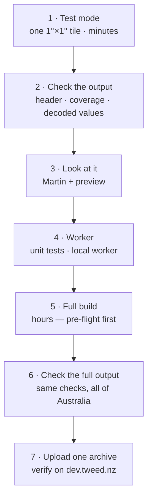

---
tags:
  - docs
  - developing
  - testing
aliases:
  - Developer workflow
  - Testing
  - Verifying pipelines
related:
  - "[[GENERATION]]"
  - "[[SERVING]]"
  - "[[worker/README]]"
  - "[[scripts/SCRIPTS]]"
updated: 2026-10-22
---

# Developing

How to change pgtiler without wasting a multi-hour build or publishing a broken
archive. Setup and the main commands are in [[README]]; why each pipeline is
shaped the way it is, is in [[GENERATION]].

> [!abstract] The rule
> Prove a change at the smallest scale that could show it's wrong, then go up a
> rung. A full Australia build takes hours, and an uploaded archive is live on
> dev **and** production the moment it lands. Both share one bucket.



---

## One-time setup

Beyond the [[README#Prerequisites|prerequisites]]:

```bash
docker compose up -d                  # Martin on :3000 — stays running
cp .env.example .env                  # then fill in R2_BUCKET, R2_REMOTE, R2_PUBLIC_URL
cd worker && npm install && npx wrangler login && cd ..   # worker work only
rclone config                         # uploads only — steps in scripts/upload-tiles.sh
```

Docker Desktop's resource settings matter for the DEM pipelines: give it most of
your CPUs (the terrain encoder uses one worker per CPU Docker reports) and enough
memory for several GDAL processes at once.

### The tools

All processing runs in Docker; nothing geospatial is installed on the host.

| Service | Image | Profile | Purpose |
|---|---|---|---|
| `martin` | `ghcr.io/maplibre/martin` | default | Tile server (PMTiles/MBTiles) on :3000 |
| `planetiler` | `ghcr.io/onthegomap/planetiler` | `generate` | OSM → OpenMapTiles vector tiles |
| `gdal` | `ghcr.io/osgeo/gdal:alpine-normal-latest` | `tools` | `gdalbuildvrt`, `gdalwarp`, `gdal_contour` |
| `rgbify` | `helmi03/rio-rgbify` (amd64, emulated on Apple Silicon) | `tools` | DEM → terrarium RGB tiles |
| `tippecanoe` | built from `docker/tippecanoe.Dockerfile` (arm64) | `tools` | GeoJSON → vector MBTiles |
| `pmtiles` | `protomaps/go-pmtiles` | `tools` | MBTiles → PMTiles, `show` |

`tools` services run on demand (`docker compose run --rm <service>`) and never
start with `docker compose up`.

### Local URLs

| URL | What |
|---|---|
| `http://localhost:3000/catalog` | Every source Martin has discovered |
| `http://localhost:3000/{source}` | TileJSON for a source |
| `http://localhost:3000/{source}/{z}/{x}/{y}` | A tile — no version segment, no extension |
| `http://localhost:8080` | MapLibre preview page (`./scripts/preview.sh`) |
| `http://localhost:8787` | Tile worker, when run with `deploy-worker.sh --local` |

---

## 1 · Test mode

Every generation script takes `--test`, which swaps the whole of Australia for a
single 1°×1° DEM tile around Bright, Victoria (`S37/E146`): alpine terrain, good
paragliding, plenty of relief to judge contours and hillshade against. It's
configured in `scripts/test-config.sh`.

```bash
./scripts/build-vrts.sh --test              # builds the -test VRTs (seconds)
./scripts/generate-terrain-tiles.sh --test  # minutes
./scripts/generate-contours.sh --test       # minutes
./scripts/generate-osm-tiles.sh --test      # minutes — still reads the full .pbf, clips with --bounds
docker compose restart martin               # pick up the new archives
```

Outputs are suffixed `-test` — `tiles/squiggly.v1.{base,contours,terrain}-test.pmtiles`,
intermediates in `datasets/tmp/*-test*`. They sit alongside the full archives
and appear as separate options in the preview, so they never overwrite real
output. `upload-tiles.sh` skips them.

The worker's test suite reads these same `-test` archives (see
[[#4 · Worker]]), so regenerate them when a pipeline's output format changes.

> [!warning] Contours cache their per-tile output
> `generate-contours.sh` skips any DEM tile whose GeoJSON already exists in
> `datasets/tmp/contours/` (or `contours-test/`). That's what makes it resumable,
> and it also means **a parameter change does nothing until you delete that folder**:
> ```bash
> rm -rf datasets/tmp/contours-test    # or datasets/tmp/contours for the full set
> ```
> Terrain and OSM always rebuild from scratch.

### What test mode can't tell you

> [!important] Things only scale reveals
> - **Seams between DEM tiles.** The test tile has no neighbours: its edges meet
>   the 0 nodata fill, not another tile. Cross-tile problems — terrain seams,
>   tippecanoe merging contours across tile edges — only show up in a multi-tile
>   build.
> - **Runtime, memory and disk.** A full build is roughly 868× the work. Use the
>   [[#5 · Pre-flight and the full build|pre-flight]] estimates, not the test
>   timings.
> - **Multipart ETags.** Test archives upload in one part and get plain MD5
>   ETags; production archives are multipart. See [[CACHING#Assumptions]].
> - **The edge cache across PoPs** and the production hostname.

There's no scripted middle rung yet: a few-dozen-tile regional build that would
catch seams in tens of minutes instead of hours. The March benchmark did this by
temporarily narrowing `TERRAIN_*` in `build-vrts.sh` (146–155°E, 27–37°S, 77 DEM
tiles, about 22 minutes for terrain). Adding a `--region` flag is the obvious
next step if this rung gets used often.

---

## 2 · Check the output

### Archive header and metadata

```bash
docker compose run --rm pmtiles show /data/tiles/squiggly.v1.terrain-test.pmtiles
```

`generate-terrain-tiles.sh` prints this at the end. What to look for:

| Archive | Tile type | Zoom | Bounds | Attribution |
|---|---|---|---|---|
| `terrain` | png | 0–12 | ≈ 146,-37 → 147,-36 for `-test`; ≈ 112,-44 → 154,-10 for full | `© Copernicus DEM` |
| `contours` | mvt | 8–14 | DEM extent | `© Copernicus DEM` |
| `base` | mvt | 0–14 | the OSM extract (or the test bounds) | OpenMapTiles / OSM |

Terrain archives built before October 2026 show whole-world bounds and no
attribution. The script now sets both (see [[GENERATION#Pipeline 3 — Terrain]]).

### Terrain: decode it and look for corruption

```bash
python3 scripts/check-terrain.py datasets/tmp/australia-terrain-test.mbtiles
python3 scripts/check-terrain.py datasets/tmp/australia-terrain.mbtiles --sample 40
```

This reads the intermediate MBTiles, so run it after encoding and before
conversion or upload. It uses only the standard library: no GDAL, Pillow or
numpy. It reports:

- **Metadata:** name, attribution and bounds present.
- **Coverage:** tile count and lon/lat extent per zoom. The full build should
  span about 112–154°E and 10–44°S at z12. If it covers only 146–154°E,
  you're looking at the old Eastern Seaboard build.
- **Spot heights:** the highest decoded point within 1.5 km of known summits
  (Kosciuszko 2228 m, Hotham 1861 m, The Horn 1723 m, Ossa, Bartle Frere, Zeil,
  Bluff Knoll, Uluru), plus a Tasman Sea point that must decode to 0. Readings
  within a few tens of metres are normal: Copernicus is a surface model.
- **Spike scan:** the largest jump between neighbouring pixels in a sample of
  z12 tiles, ignoring the 0 fill. Normal terrain stays in the tens of metres.
  Resampling *encoded* terrarium corrupts heights at every 256 m boundary,
  which shows up as jumps of 100+ m ([[GLOSSARY#Terrarium encoding]]).

It exits non-zero and lists the problems if anything fails.

Reference result: on the old Eastern Seaboard archive it reads Kosciuszko at
2226 m and Hotham at 1860 m, with spike-scan maxima around 5–20 m. The test tile
reads The Horn at 1703 m.

> [!tip] Cross-checking against the source DEM
> To compare a decoded height with the raw DEM at the same point:
> ```bash
> docker compose run --rm gdal gdallocationinfo -valonly -wgs84 \
>   /data/datasets/sources/australia-terrain-test.vrt 146.7667 -36.7667
> ```
> Arguments are longitude then latitude. Expect small differences, because the
> tile value is resampled.

### Contours and base

There's no decoding script for the vector archives. `pmtiles show` plus a look in
the preview covers them. For contours, check the metadata lists layer `contours`
with fields `elevation` and `ID`. There is no `is_major` field: see
[[GENERATION#Pipeline 2 — Contours]].

---

## 3 · Look at it

```bash
docker compose restart martin     # after any new archive
./scripts/preview.sh              # http://localhost:8080
```

The sidebar has fixed option groups: **Maps**, **Contours**, **Hillshade**,
**Terrain** and **Styles**. Each local layer has a full and a `-test` option. If
`R2_PUBLIC_URL` is set, remote options load from that worker as well (see
[[#7 · Upload and verify on dev]]). Details are in [[preview/PREVIEW]].

What to look for:

- **Hillshade and 3D terrain:** spikes, pits or terracing that follow contour
  lines (encoding corruption); straight-line seams along whole-degree lines
  (tile edges, full builds only); flat holes where land should be (nodata).
- **Contours:** lines that stay continuous across zooms 8–14. Visibly stepped,
  grid-following lines mean the smoothing pass didn't run. Gaps in dense
  alpine areas mean features were dropped.
- **Base:** a test build is clipped to the Bright tile, so blank outside it is
  expected.

---

## 4 · Worker

```bash
cd worker
npm run typecheck     # worker source and tests, separately
npm test              # vitest against the real tiles/*-test.pmtiles archives
```

Both run automatically before `deploy-worker.sh dev` and `production`, which
abort on failure.

To run the worker itself locally, seed its R2 emulation with the test archives,
then start it:

```bash
cd worker
for a in base contours terrain; do
  npx wrangler r2 object put squiggly-maps-v1/squiggly.v1.$a-test.pmtiles \
    --file ../tiles/squiggly.v1.$a-test.pmtiles --local
done
cd .. && ./scripts/deploy-worker.sh --local     # http://localhost:8787

curl -s http://localhost:8787/                                  # archive index
curl -s http://localhost:8787/squiggly.v1.terrain-test.json     # TileJSON: check bounds + attribution
```

`./scripts/deploy-worker.sh --local-remote` runs the same worker against the
**real** bucket, read-only. It's the only local mode that exercises production
archives and their multipart ETags. Layout, config and deploy targets are in
[[worker/README]].

---

## 5 · Pre-flight and the full build

- [ ] The changed pipeline passes steps 1–3 in test mode.
- [ ] **Disk:** `df -h .` Rough needs on top of what's already there:
  - Terrain: about 26 GB merged GeoTIFF, plus MBTiles and PMTiles of very
    roughly 40–60 GB each for all of Australia. That's an estimate scaled
    from the benchmark, not a measurement.
  - Contours: the smoothed DEM tiles, about 50 MB each uncompressed (≈ 45 GB
    for 868), held until the run finishes, plus the GeoJSON.
- [ ] **Docker resources:** CPUs and memory set as above. Override the terrain
  worker count with `RGBIFY_WORKERS=N` if needed.
- [ ] **Time:** terrain for all of Australia is estimated at 4–5 hours with about
  10 workers (scaled from the benchmark), longer with fewer. Contours take hours.
- [ ] **Keep the Mac awake:** prefix the command with `caffeinate -is`.
- [ ] **Keep the current archive for rollback,** outside `tiles/`. Martin serves
  everything in `tiles/`, and `upload-tiles.sh` uploads every non-test
  `squiggly.v1.*.pmtiles` there.
  ```bash
  mkdir -p datasets/tmp/previous
  cp tiles/squiggly.v1.terrain.pmtiles datasets/tmp/previous/
  ```
  The terrain script only replaces `tiles/squiggly.v1.terrain.pmtiles` once the
  new one is fully written, so the old archive keeps serving locally until then.

```bash
caffeinate -is ./scripts/generate-terrain-tiles.sh
```

## 6 · Check the full output

Run the same checks as step 2 at full scale:

```bash
python3 scripts/check-terrain.py datasets/tmp/australia-terrain.mbtiles --sample 40
docker compose run --rm pmtiles show /data/tiles/squiggly.v1.terrain.pmtiles
docker compose restart martin && ./scripts/preview.sh
```

In the preview, visit regions the test tile can't represent: the Kimberley, the
Flinders Ranges, Tasmania, the Great Dividing Range. Also check a whole-degree
line or two for seams.

---

## 7 · Upload and verify on dev

Upload only the archive that changed. `upload-tiles.sh` uploads every non-test
archive in `tiles/`; rclone should skip unchanged ones, but the explicit form
leaves no doubt:

```bash
source .env
rclone copyto tiles/squiggly.v1.terrain.pmtiles \
  "$R2_REMOTE:$R2_BUCKET/squiggly.v1.terrain.pmtiles" --progress --s3-chunk-size 64M
```

Keep `--s3-chunk-size 64M`. The ETag depends on the chunk size, and the tile
version code is taken from the ETag ([[CACHING#^assumption-2|Assumption 2]]).

> [!danger] There is no staging bucket
> dev and production read the same R2 bucket, so the moment an upload completes
> it is live on both. Tiles at the new version are cached `immutable` for a year,
> so a bad archive pins itself until the next upload
> ([[CACHING#Hazard: a bad deploy pins itself for a year]]). Steps 1–6 are the
> only gate.

Nothing else needs to happen after an upload: no worker redeploy, no style
upload, no purge. The new ETag moves every tile to a new URL. The worker notices
within 60 s, and TileJSON's 5-minute cache does the rest
([[CACHING#Versioning and redeploys]]).

Verify against dev:

```bash
curl -s https://dev.tweed.nz/squiggly.v1.terrain.json      # new version in "tiles", bounds, attribution
curl -sD- -o /dev/null https://dev.tweed.nz/squiggly.v1.terrain/<version>/8/210/151.png \
  | grep -iE '^HTTP|x-tile|content-type'                    # Perth: 200 + image/png, not 204
R2_PUBLIC_URL=https://dev.tweed.nz ./scripts/preview.sh     # real browser, real worker
```

**Rollback** means re-uploading the previous archive from
`datasets/tmp/previous/` the same way. It gets a new ETag, so it's a forward move
to new URLs, not a cache restore.

---

## Committing

- Docs change in the same commit as the code they describe. [[CLAUDE]] has the
  checklist of which doc covers what.
- Worker changes: `npm run typecheck && npm test` pass before committing, not
  just before deploying.
- Generated output never goes in git: `tiles/`, `datasets/sources/` and
  `datasets/tmp/` are ignored wholesale.

---

## Changing the region

1. Change the Geofabrik URL and filename in `scripts/download-osm-base-vectors.sh`.
2. Change the bounding box in `scripts/download-copernicus-dem.sh` (`SOUTH`,
   `NORTH`, `WEST`, `EAST`).
3. Change the terrain region in `scripts/build-vrts.sh` (`TERRAIN_SOUTH`, etc.).
   It currently matches the DEM download.
4. Pick a test tile inside the new region in `scripts/test-config.sh`, and
   update the summits in `scripts/check-terrain.py`.
5. Work through this page from step 1.
