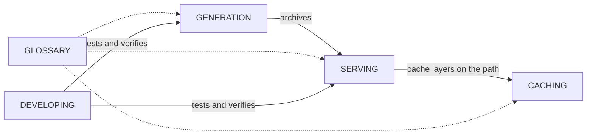

---
tags:
  - docs
  - moc
aliases:
  - Docs index
  - Architecture
  - Home
related:
  - "[[README]]"
  - "[[CLAUDE]]"
updated: 2026-10-22
---

# Docs

The entry point to pgtiler's documentation. [[README]] is the short version —
setup and the main commands. [[DEVELOPING]] is how to work on the project: test
mode, verifying output, and what to check before a multi-hour build. The other
notes are the design record: why the system is shaped the way it is.

These notes are written for [Obsidian](https://obsidian.md/) with the repo root
as the vault. Links are wikilinks, so on GitHub they show as plain `[[text]]`.

---

## Notes

| Note | Covers |
|---|---|
| [[DEVELOPING]] | The developer workflow — test mode, checking output, local servers, before and after a full build |
| [[GENERATION]] | How source data becomes the three PMTiles archives, and why each pipeline is shaped that way |
| [[SERVING]] | How a tile gets from an archive to the screen — formats, URL schemes, the request path |
| [[CACHING]] | The four cache layers, versioning and redeploys, and what is verified versus assumed |
| [[GLOSSARY]] | Every term the notes lean on, defined once |

---

## Open threads

What is known to be wrong, unverified or undecided, gathered in one place:

- [[GENERATION#Known gaps]] — terrain coverage and metadata, the duplicate VRTs,
  no incremental rebuilds
- [[CACHING#Assumptions]] — Cloudflare and R2 behaviour we rely on but don't control
- [[CACHING#Open questions]] — dev exposure, TileJSON revalidation, cold starts
- [[SERVING#Assumptions]] — naming conventions nothing enforces
- [[TODO]] — the work list

## Elsewhere in the repo

- [[README]] — setup, pipelines, deployment
- [[worker/README|Worker README]] — the Cloudflare Worker's layout, config and deploys
- [[scripts/SCRIPTS|Scripts]] — one line per script
- [[datasets/DATASETS|Datasets]] — what lives in `datasets/`
- [[preview/PREVIEW|Preview]] — the MapLibre preview page
- [[CLAUDE]] — instructions for Claude, including how to maintain these notes

---

## Conventions

How these notes are written, so they stay consistent as they change.

**Frontmatter.** Every note starts with YAML properties:

| Property | Use |
|---|---|
| `tags` | `architecture` for design notes, `docs` for the rest, plus topic tags (`caching`, `terrain`, …) |
| `aliases` | Other names the note answers to in search and link autocomplete |
| `related` | Wikilinks to the closest notes — shown in the properties panel |
| `updated` | Date of the last substantive change. Bump it when you edit the note |

**Links.** Wikilinks between notes, including to a heading
(`[[CACHING#Layer 2 — The Cloudflare edge|layer 2]]`) or to a block ID
(`[[CACHING#^assumption-3|Assumption 3]]`). Notes outside `docs/` are
linked by path from the vault root (`[[worker/README]]`). External URLs stay as
Markdown links. GitHub-facing docs (`README.md`, `scripts/SCRIPTS.md`, …) keep
Markdown links.

**Renaming a heading breaks links to it.** Obsidian updates links when a *file*
is renamed, not when a heading is. Search the vault for `#Old heading` before
renaming one.

**Terms** are defined once, in [[GLOSSARY]], and linked from where they are used.

**Callouts** carry the things a reader must not miss:

| Callout | Meaning |
|---|---|
| `> [!abstract]` | The short version of a note |
| `> [!info]` | A pointer elsewhere |
| `> [!note]` | A correction, or something easy to get wrong |
| `> [!important]` | A constraint that decides the design |
| `> [!warning]` | Known-wrong state: metadata, coverage, stale facts |
| `> [!danger]` | A failure mode that does lasting damage if triggered |

**Block IDs** (`^assumption-3`) mark items other notes cite by number, so the
reference survives reordering.

**Code references** name the file and line, e.g. `worker/src/handler.ts:96`.
They drift when code moves, so check them when you touch the code.
