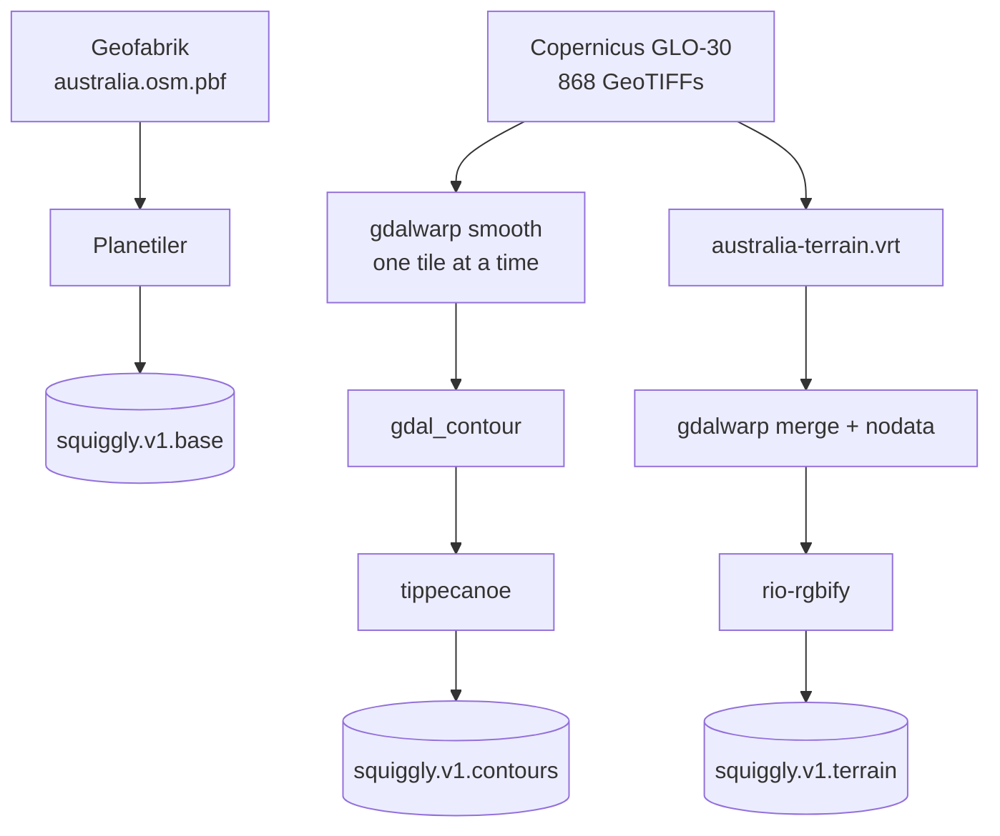
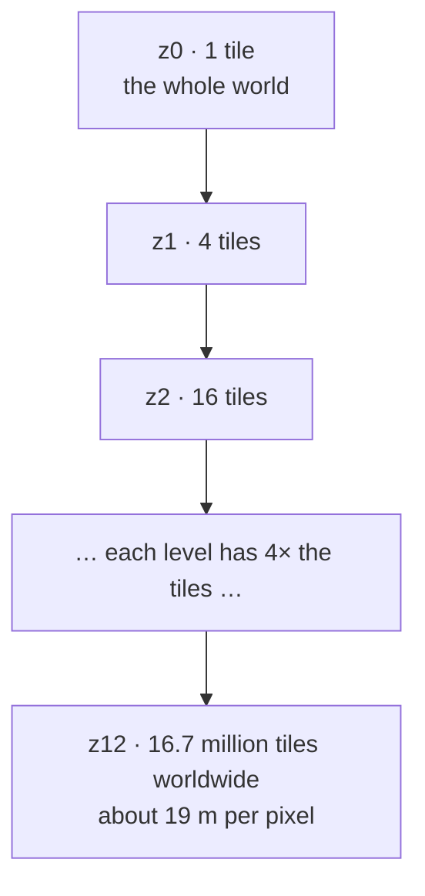
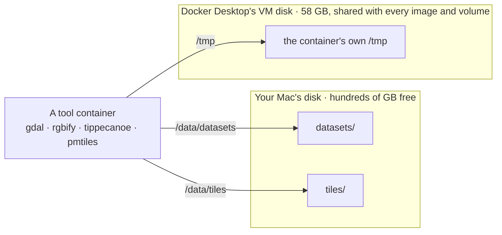
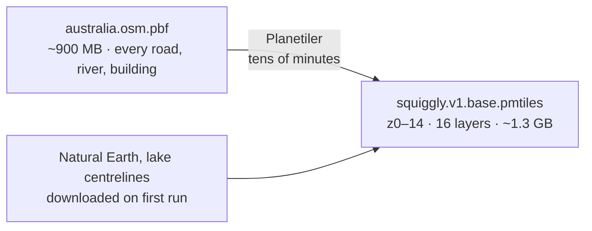
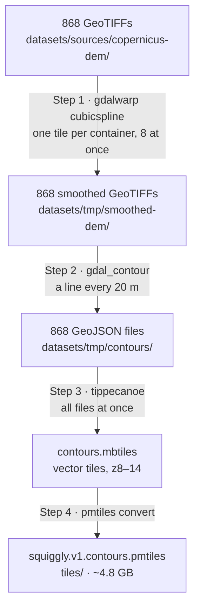
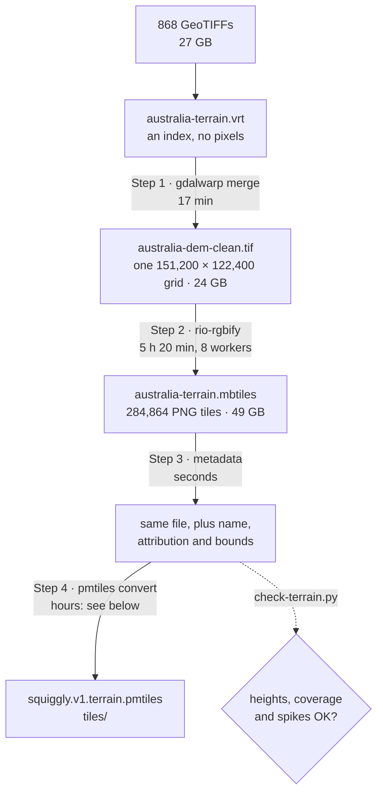
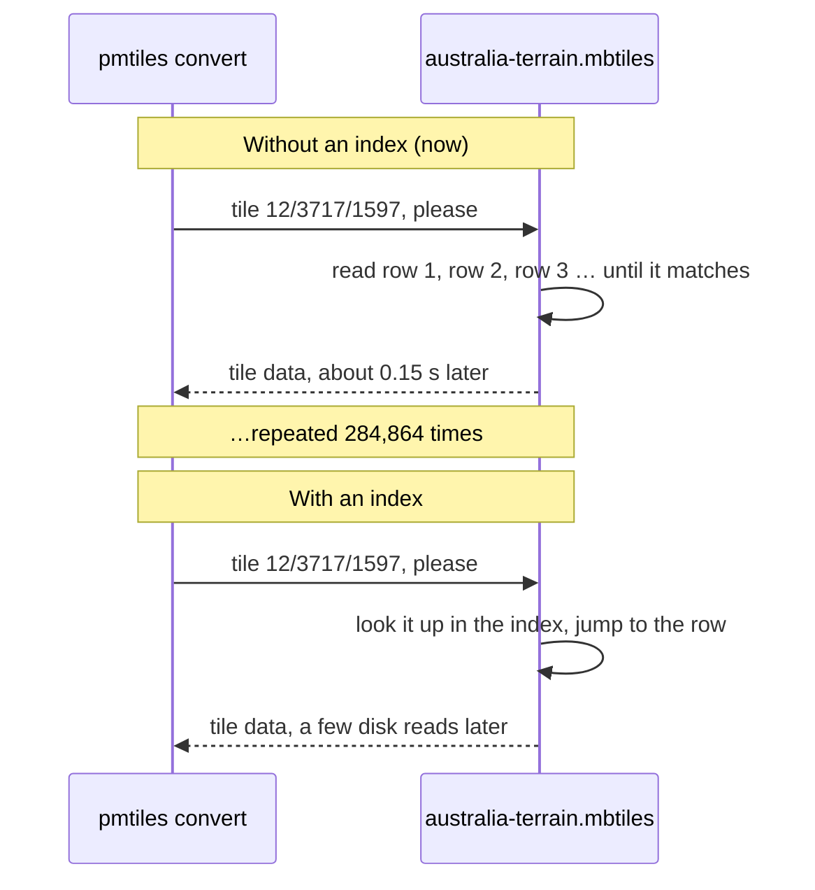

---
tags:
  - architecture
  - generation
  - pipeline
  - dem
  - terrain
  - contours
aliases:
  - Pipelines
  - Tile generation
  - How the pipelines work
related:
  - "[[DEVELOPING]]"
  - "[[SERVING]]"
  - "[[CACHING]]"
  - "[[GLOSSARY]]"
  - "[[scripts/SCRIPTS]]"
  - "[[TODO]]"
updated: 2026-10-23
---

# Generation

How source data becomes the three PMTiles archives, step by step, and why each
pipeline is shaped the way it is. It starts with the handful of ideas everything
else depends on, then walks each pipeline from download to finished archive.

What to run and how to check the output is [[DEVELOPING]]. Serving the result is
[[SERVING]], and terms are defined in [[GLOSSARY]].

> [!abstract] The short version
> Two downloads go in: an OpenStreetMap extract, and 868 squares of elevation data.
> Three archives come out: the base map, contour lines and terrain. Each is cut into
> map tiles at every zoom level, then packed into one PMTiles file that the worker
> serves. Every tool runs in Docker. Nothing is incremental: a change rebuilds the
> whole layer, and the terrain build takes most of a day.

---

## Shape of the thing

Three independent pipelines producing three archives. Two of them share a source.



The OSM pipeline is one tool and one step. Both DEM pipelines read the same 868
tiles and differ only in what they pull out: separate labelled lines for
contours, a continuous height surface for terrain.

Nothing is incremental. Each pipeline rebuilds its archive from scratch, so the
practical unit of work is "regenerate a whole layer".

---

## The ideas you need first

### Elevation data is a grid of numbers

A [[GLOSSARY#DEM|DEM]] (digital elevation model) is a picture where each pixel is
a height in metres instead of a colour. Copernicus publishes the planet as 1°×1°
squares. Each one is a GeoTIFF of 3600 × 3600 pixels, and each pixel covers about
30 m × 30 m of ground.

Neither pipeline adds information. Contours draw lines through these heights, and
terrain re-encodes them so a browser can read them. Both can only be as good as
this grid.

### Maps are served as tiles, in a pyramid

A web map is never one image. It's a grid of small square **tiles**, and the
viewer downloads only the ones on screen. Each zoom level splits every tile into
four, so detail grows by 4× per level. That stack of levels is the
[[GLOSSARY#Tile pyramid|tile pyramid]].



Covering only Australia keeps this manageable. The terrain archive's counts per
zoom, from the October 2026 build. Its tiles are 512 × 512 pixels, and pixel
sizes are at the equator; across Australia they're 10–25% smaller.

| Zoom | Tiles | Roughly one pixel is |
|---|---:|---|
| 8 | 868 | 300 m |
| 9 | 3,416 | 150 m |
| 10 | 13,552 | 75 m |
| 11 | 53,520 | 38 m, about the source's 30 m |
| 12 | 213,155 | 19 m, finer than the source |
| **0–12** | **284,864** | |

Three-quarters of all tiles are in the deepest level. That's why the last zoom
level dominates the time and space of every pipeline.

### The file formats along the way

Each pipeline hands its data through several formats. Every one has a single job.

| Format | What it is | Where it lives |
|---|---|---|
| **GeoTIFF** (`.tif`) | An image of heights, with its position on Earth attached | `datasets/sources/copernicus-dem/`, and merged or smoothed copies in `datasets/tmp/` |
| **[[GLOSSARY#VRT\|VRT]]** (`.vrt`) | A small XML list that makes many GeoTIFFs look like one. It copies no pixels | `datasets/sources/` |
| **GeoJSON** (`.geojson`) | Lines and shapes as text. Used for contour lines between tracing and tiling | `datasets/tmp/contours/` |
| **[[GLOSSARY#MBTiles\|MBTiles]]** (`.mbtiles`) | A SQLite database with one row per tile. Easy for tools to write | `datasets/tmp/`, intermediate only |
| **[[GLOSSARY#PMTiles\|PMTiles]]** (`.pmtiles`) | One file holding every tile, in an order that lets any tile be fetched with a single byte-range read. Fast to serve | `tiles/`, then R2 |

MBTiles is what the tile-making tools know how to write. PMTiles is what the
[[SERVING|worker]] knows how to serve. So the last step of every pipeline except
OSM is the same: `pmtiles convert` repackages one as the other.

### Everything runs in Docker

No geospatial tools are installed on the Mac. Each step runs in a throwaway
container (`docker compose run --rm <service>`), which sees the project through
two shared folders.



> [!important] Big temporary files must go to `/data/datasets`, never `/tmp`
> Anything a container writes outside the two shared folders lands on Docker's
> VM disk. That disk is small and already holds the images. The first full terrain
> build (October 2026) died at 81% of its final step because `pmtiles convert`
> staged a ~40 GB temp file in `/tmp`. The script now passes
> `--tmpdir=/data/datasets/tmp`. See [[#Step 4 — Convert to PMTiles]].

| Service      | Tool                                                          | Runs natively on Apple Silicon? |
| ------------ | ------------------------------------------------------------- | ------------------------------- |
| `gdal`       | GDAL: `gdalbuildvrt`, `gdalwarp`, `gdal_contour`              | Yes (arm64)                     |
| `rgbify`     | rio-rgbify, a 2018 image                                      | **No: amd64, emulated**         |
| `tippecanoe` | tippecanoe, built locally from `docker/tippecanoe.Dockerfile` | Yes (arm64)                     |
| `pmtiles`    | go-pmtiles                                                    | Yes (arm64)                     |
| `planetiler` | Planetiler (Java)                                             | Yes (arm64)                     |

Emulation makes rio-rgbify slower than it needs to be. It's the 5-hour step of
the terrain build, so a native build of it is the most promising speed-up. That's
unmeasured.

---

## Source data

| Dataset | Extent | On disk | Licence |
|---|---|---|---|
| OSM Australia (Geofabrik) | national extract | ~0.9 GB, plus ~1.4 GB of Planetiler's auxiliary downloads | ODbL — attribution required |
| Copernicus GLO-30 DEM | 112°–154°E, 44°–10°S | **27 GB, 868 tiles** | Copernicus — attribution required |
| Natural Earth | global | fetched by Planetiler `--download` | public domain |

The DEM bounding box is a 34 × 42 grid, so 1,428 tiles are possible; 868 exist
because the rest are open ocean and Copernicus doesn't publish empty tiles. Each
is a 1°×1° GeoTIFF of elevation in metres at 30 m resolution.

No AWS account is needed — `s3://copernicus-dem-30m` is public and the script
uses `--no-sign-request`, downloading 10 tiles in parallel via `xargs -P`.

---

## The VRT layer

`gdalbuildvrt` produces an XML index that makes N GeoTIFFs look like one seamless
raster to every downstream GDAL tool. No pixel data is copied, so building it is
seconds and costs kilobytes.

The paths inside the VRT are **container paths** (`/data/datasets/...`), not host
paths. The VRT is only ever read from inside the `gdal` container, and this is
the reason it can't be used from the host without rewriting.

### The two VRTs are now the same file in all but name

`build-vrts.sh` produces both `australia-dem.vrt` and `australia-terrain.vrt`.
They were meaningfully different when terrain covered only the Snowy Mountains
and a 400 km radius around Manilla, NSW — about 90 tiles against the full set.

Terrain has since been expanded to all of Australia, using the same bounding box
as the DEM download. **Both VRTs now index the identical 868 tiles.**

> [!note] Nothing reads `australia-dem.vrt`
> It's documented as the contour pipeline's input, but `generate-contours.sh`
> loops over the GeoTIFFs in `datasets/sources/copernicus-dem/` directly and never
> opens a VRT. Checked 2026-10-23 by searching `scripts/`. Only
> `generate-terrain-tiles.sh` reads a VRT, `australia-terrain.vrt`. The other VRT
> is built, described in [[CLAUDE]] and [[scripts/SCRIPTS]], and unused.

> [!info] The terrain archive now covers all of Australia
> Until October 2026 the terrain archive covered only the Eastern Seaboard
> (146–154°E, 27–37°S, 16,805 tiles from the March benchmark), although the
> config had been widened. The first full build ran on 2026-10-22–23. Its MBTiles
> spans 112–154°E, 10–44°S and passes `check-terrain.py`. See
> [[#The first full-Australia build]].

---

## Pipeline 1 — OSM base map



**What happens, step by step:**

1. **Read the extract.** Planetiler reads every OSM feature in Australia: roads,
   rivers, coastlines, place names, buildings.
2. **Sort features into layers.** Each feature goes into one of 16 layers of the
   [OpenMapTiles](https://openmaptiles.org/schema/) schema, such as
   `transportation`, `water` or `place`.
3. **Decide what each zoom shows.** At low zoom it drops small features and
   simplifies shapes: no footpaths at country scale, smooth coastlines. At z14
   nearly everything is kept.
4. **Write PMTiles directly.** Unlike the other two pipelines there's no MBTiles
   intermediate, so no conversion step.

Choosing a published schema rather than a bespoke one is what lets off-the-shelf
styles work against these tiles, and why `styles/` can be edited in Maputnik.

`--download` fetches the auxiliary datasets Planetiler needs (Natural Earth for
low-zoom land polygons, lake centrelines) on first run.

Test mode passes `--bounds` to clip to the Bright tile rather than using a
separate input file.

Output: z0–14, 16 layers, attribution baked into the archive metadata.

---

## Pipeline 2 — Contours



**What happens, step by step:**

1. **Smooth each DEM tile.** `gdalwarp -r cubicspline` resamples every GeoTIFF
   into `datasets/tmp/smoothed-dem/`. This softens the pixel grid so the traced
   lines don't come out stair-stepped. Eight tiles run at once, each in its own
   container.
2. **Trace the lines.** `gdal_contour -i 20` walks each smoothed tile and draws a
   line wherever the ground crosses a multiple of 20 m. Each line gets an
   `elevation` attribute. Output is one GeoJSON file per DEM tile.
3. **Cut into vector tiles.** Tippecanoe reads all 868 GeoJSON files at once. It
   joins lines across tile edges, simplifies them for each zoom, and writes vector
   tiles for z8–14 into an MBTiles file.
4. **Convert to PMTiles.** `pmtiles convert` repackages the MBTiles. Tippecanoe's
   MBTiles has a proper index (`map_index`), so this step is quick, unlike terrain's
   ([[#Step 4 — Convert to PMTiles|see below]]).

Steps 1 and 2 skip any tile whose output already exists, so an interrupted run
resumes where it stopped. The smoothed GeoTIFFs are deleted at the end.

### Why upsample before tracing

`gdal_contour` walks the raster grid, so at native 30 m resolution the traced
lines inherit the grid and come out visibly stepped. Resampling with cubic
spline (`-tr 0.000277778`) before tracing gives the tracer a smoother
surface and the lines follow the terrain rather than the pixels.

This is interpolation, not new information — it buys visual quality, not
accuracy. Resampling elevation is safe here in a way it explicitly is not for
terrain (see [[#Why rio-rgbify, despite being the slowest correct option|Pipeline 3]]).

> [!warning] It isn't actually a 3× upsample
> The source tiles are already 1 arc-second: 3600 × 3600 pixels at
> 0.000277778° (checked 2026-10-22 against the GeoTIFF headers of S37/E146,
> S12/E132 and S43/E146). So `-tr 0.000277778` resamples at the *native*
> resolution, not 3× finer. `SMOOTH_FACTOR=3` in the script is never used.
>
> It isn't a no-op either: GDAL's `cubicspline` is an approximating B-spline, so
> it still smooths the surface. The contours are smoothed, just not upsampled. A
> true 3× would be `-tr 0.0000925926 0.0000925926` — about 9× the pixels per
> tile, with the disk space and gdal_contour time to match. Test it on the
> `--test` tile before trying it at scale.

### Why per-tile, and why 8 at a time

Each of the 868 tiles is smoothed and traced independently, 8 containers at a
time via `xargs -P`. Per-tile work is what makes the parallelism possible at all,
and it makes the step **resumable** — both stages skip tiles whose output already
exists, so an interrupted run picks up where it stopped rather than restarting.

Tippecanoe then merges every GeoJSON at once, which is where cross-tile
consistency is recovered.

### Parameters

| Setting | Value | Why |
|---|---|---|
| Contour interval | 20 m | Fine enough for terrain reading, coarse enough to stay legible |
| Zoom range | 8–14 | Below z8 contours are unreadable; z14 matches the base map |
| `--simplification` | 4 | Douglas-Peucker tolerance; higher loses switchbacks |
| `--detect-shared-borders` | on | Keeps adjacent lines from separating under simplification |
| `--no-feature-limit`, `--no-tile-size-limit` | on | Dense alpine tiles legitimately exceed tippecanoe's defaults; dropping features would leave holes |

Output attributes are `elevation` (metres) and `ID` (a gdal_contour serial).

> [!note] There is no `is_major` attribute.
> `MAJOR_INTERVAL=100` exists in the script, but `gdal_contour` is only ever passed `-a elevation`, so nothing
> generates a major/minor flag. Confirmed against the published TileJSON — the
> layer's fields are `ID` and `elevation`. The script used to advertise
> `is_major` in its output; that message has been corrected. Style index
> contours with a modulo expression instead:
> `["==", ["%", ["get", "elevation"], 100], 0]`.

---

## Pipeline 3 — Terrain



Times and sizes are from the first full-Australia build, 2026-10-22–23, with
Docker given 8 CPUs and 8 GB of memory.

### Step 1 — Merge into one height map

`gdalwarp` reads the 868 tiles through the VRT and writes a single GeoTIFF of all
of Australia: 151,200 × 122,400 pixels, DEFLATE-compressed, 24 GB. Wherever no
DEM tile exists (open ocean), it writes 0, meaning sea level.

#### Why a merged GeoTIFF first

`rio-rgbify` does not respect GDAL nodata masks. Fed the VRT directly, the gaps
between tiles read as garbage floats and crash the encoder. `gdalwarp` merges
everything into one DEFLATE-compressed, tiled, BIGTIFF GeoTIFF with
`-dstnodata 0`, which flattens gaps to sea level. It took 73 s on the benchmark
subset and 17 minutes for all of Australia.

The log fills with `Value 0 in the source dataset has been changed to
1.4013e-45` warnings. Those are harmless: GDAL nudges real 0 m pixels by a
negligible amount so they aren't mistaken for gaps, and they still decode to
0 m.

### Step 2 — Encode heights as colours (rio-rgbify)

This is the slow step. For every tile in the pyramid, z0 to z12, rio-rgbify:

1. **Works out which patch of Australia the tile covers.**
2. **Reads that patch from the merged GeoTIFF and resamples it** to 512 × 512
   pixels. At z11 that's close to the 30 m source. At z12 it's finer than the
   source, so pixels are interpolated between real readings. At z0 the whole
   continent is squeezed into a few pixels.
3. **Encodes each pixel's height as a colour** using
   [[GLOSSARY#Terrarium encoding|terrarium encoding]] (below), and saves the result
   as a PNG.
4. **Stores the PNG as one row in the MBTiles database.**

Eight worker processes share the tiles, one per CPU Docker has. Zoom levels are
written in order, z0 first, but within a zoom the rows land in whatever order the
workers finish. That matters in step 4.

#### Terrarium encoding

Elevation is packed into the RGB channels of an ordinary PNG:

```
elevation = (R × 256 + G + B ÷ 256) − 32768
```

Read it as a three-digit number in base 256. Add 32,768 so negative heights
(below sea level) still fit. Then R is the "256s" digit, G the units, and B the
fraction. A worked example for The Horn, at 1,703 m:

| | Value |
|---|---|
| 1,703 + 32,768 | 34,471 |
| R = 34,471 ÷ 256, rounded down | **134** |
| G = what's left over | **167** |
| B = fraction | **0** |
| Check: 134 × 256 + 167 − 32,768 | 1,703 m ✓ |

rio-rgbify parameterises this as `base_val + (R×65536 + G×256 + B) × interval`,
hence the `--base-val -32768 --interval 0.00390625` (1/256) in the script.

Nobody views the image. MapLibre's [[GLOSSARY#raster-dem|raster-dem]] source
decodes it back to heights for hillshade and 3D terrain.

#### Why rio-rgbify, despite being the slowest correct option

This was benchmarked properly (March 2026, Eastern Seaboard subset, 69 DEM tiles,
z0–12, 16,805 tiles). The constraint that decides it:

> [!important] Terrarium is a base-256 number, so resampling the encoded RGB breaks it.
> Averaging R, G and B independently is meaningless at every 256 m boundary where
> G wraps 255→0 and R increments. The carry relationship is destroyed and the
> error reaches 128 m — visible as spikes along contour lines. The only correct
> order is resample the raw elevation, *then* encode per pixel.

What that looks like across one boundary, averaging two neighbouring pixels to
make a lower zoom:

| | Height | R | G |
|---|---:|---:|---:|
| Pixel A | 255 m | 128 | 255 |
| Pixel B | 256 m | 129 | 0 |
| Average the *heights*, then encode | 255.5 m | 128 | 255 (+ B = 128) |
| Average the *colours* | **127 m** | 128 | 127 |

The right answer is 255.5 m. Averaging the colours gives 127 m. One step to the
side, the same mistake gives 384 m. Repeat that along every 256, 512 and 768 m
contour and you get the spiky terrain the March GDAL experiments produced. Those
experiment files were deleted on 2026-10-22, after one was found still in `tiles/`
as the `-test` archive ([[DEVELOPING#2 · Check the output]]).

| Approach | Time | Output | Verdict |
|---|---:|---:|---|
| **rio-rgbify (single, 10 workers)** | **1320 s** | 4.9 G | **Correct** — resamples then encodes |
| GDAL from terrarium VRT (bilinear) | 1027 s | 4.5 G | Broken — artifacts at 256 m boundaries |
| GDAL from terrarium VRT (nearest) | 151 s | 2.9 G | No artifacts, unacceptable aliasing |
| Custom Python tiler | 397 s | 4.8 G | Tile-boundary seams; 4 iterations, abandoned |
| rio-rgbify, zoom split 3 ways | 2244 s | 4.9 G | Correct but 1.7× slower |
| rio-rgbify, zoom split 6 ways | 21953 s | 4.9 G | 16.6× slower |

Two conclusions worth keeping:

- **gdal2tiles cannot do this at all** — it has no plugin point between resample
  and write, so it can only resample already-encoded values.
- **Splitting rio-rgbify across zoom levels makes it dramatically worse.** Each
  process re-reads the entire GeoTIFF, thrashing I/O and memory. Its internal
  `-j` workers are far more efficient than external parallelism. This is the
  opposite of the contour pipeline, where per-tile parallelism is the whole
  trick — the difference is that contour work partitions cleanly and terrain
  encoding does not.

The bottleneck within this step is tile encoding and PNG writing, not the warp.

> [!note] Worker count
> The benchmark ran 10 workers, but until October 2026 the script never passed
> `-j`, so real builds ran at rio-rgbify's default of 4. It now passes one worker
> per CPU Docker has (`RGBIFY_WORKERS=N` overrides).

Output: z0–12, 512 × 512 pixel tiles. z12 is about 19 m/pixel at the equator,
finer than the 30 m source; z11, at about 38 m, is the level that roughly
matches it. Checked 2026-10-23 against a tile's PNG header. Earlier notes said
~38 m at z12, which assumed 256-pixel tiles. Whether z12 is worth its 213,155
tiles is an open question in [[TODO]].

### Step 3 — Label the archive

rio-rgbify records nothing about what it made. A short Python script, run in the
`rgbify` container, writes the archive's name, description, attribution
(`© Copernicus DEM`), zoom range and bounds into the MBTiles `metadata` table.
The bounds come from the merged GeoTIFF's extent. `pmtiles convert` carries these
into the PMTiles header, and the worker builds TileJSON from them.

> [!warning] Terrain metadata was wrong, and it isn't cosmetic
> Archives built before October 2026 declare global bounds (`-180,-85 → 180,85`),
> carry an empty `name`, and have **no `attribution`**, although Copernicus
> requires it. Contours get theirs from tippecanoe's `--attribution` flag;
> rio-rgbify has no equivalent, so nothing set it. Clients that render attribution
> automatically from TileJSON show nothing for terrain.
>
> **Fixed in the script, October 2026,** by this step. Verified on the 2026-10-23
> full-build MBTiles: name, attribution and bounds 112–154°E, 10–44°S are all
> present. The archive on R2 still has the problem until the new one is uploaded.

### Step 4 — Convert to PMTiles

`pmtiles convert` reads every tile back out of the MBTiles and writes it into
PMTiles order: a Hilbert curve, so tiles that are neighbours on the map are
neighbours in the file. It does this in two passes:

1. **List every tile** (z, x, y) in the database, which is quick, and sort them into
   PMTiles order.
2. **Fetch each tile's image, one at a time, in that order,** and append it to a
   temp file. Identical tiles, such as all-sea tiles, are stored once. Finally,
   write the header and directory and copy the tile data in behind them.

For contours this takes minutes. For terrain it currently takes hours, for two
separate reasons.

#### Problem 1 — no index on the tiles table

rio-rgbify creates its `tiles` table with no index on `(zoom_level, tile_column,
tile_row)`. The MBTiles spec recommends one, and tippecanoe creates one. Without
it, SQLite can find a tile only by reading through the table from the start until
it reaches the matching row:



rio-rgbify writes the zoom levels in order. In the 2026-10-23 MBTiles, z0–z11
fill the first 71,709 rows and z12 fills the remaining 213,155. Within a zoom,
rows are in whatever order the workers finished. The converter also works zoom
by zoom, so:

- **z0–z11 are quick.** Their rows are near the front, and the run started at
  about 115 tiles a second.
- **Every z12 lookup is slow.** It has to read past all 71,709 lower-zoom rows,
  then on average half of the z12 rows. The run slowed to about 7 tiles a second.

The total time grows roughly with the *square* of the tile count. The 16,805-tile
Eastern Seaboard archive converted without anyone noticing. At 284,864 tiles,
about 17 times as many, the same step takes hours.

**Verified (2026-10-23):**
- `EXPLAIN QUERY PLAN` on the converter's lookup reports `SCAN tiles`.
- One lookup run directly on the Mac, outside Docker, with the file cached, took
  about 0.2 s, which is slower than the converter manages inside Docker. **Docker
  is not the bottleneck here.**

**Proposed fix (not yet applied or measured):** create the index in step 3, before
converting:

```sql
CREATE UNIQUE INDEX tile_index ON tiles (zoom_level, tile_column, tile_row);
```

Building it means reading the table once. Expected: about a minute to build, and
the conversion limited by disk speed, minutes rather than hours. Both figures are
unmeasured.

#### Problem 2 — the temp file landed on Docker's small disk

Pass 2's temp file grows to about the size of the MBTiles. By default it goes in
the container's `/tmp`, which is Docker's 58 GB VM disk, not the Mac's disk (see
[[#Everything runs in Docker]]). With images and volumes already using 23 GB of
it, the first full conversion failed at 81% with
`write /tmp/pmtiles…: no space left on device`, after 4 hours.

**Fixed (2026-10-23):** the script passes `--tmpdir=/data/datasets/tmp`, so the
temp file goes on the Mac's disk. Checked on the test archive: the output is
byte-identical and the temp file is removed afterwards.

### Checking the result

`scripts/check-terrain.py` reads the MBTiles after step 3 and decodes real
heights from it: metadata present, coverage per zoom, known summits within
100 m, a sea point at 0 m, and no 150 m+ jumps between neighbouring pixels.
How to run it is in [[DEVELOPING#2 · Check the output]].

### The first full-Australia build

2026-10-22 to 2026-10-23, Docker with 8 CPUs and 8 GB of memory:

| Step | Time | Output |
|---|---|---|
| 1 · Merge | 17 min | `australia-dem-clean.tif`, 24 GB |
| 2 · Encode | 5 h 20 min | `australia-terrain.mbtiles`, 49 GB, 284,864 tiles |
| 3 · Metadata | seconds | name, attribution, bounds |
| 4 · Convert, attempt 1 | failed after 4 h 5 min at 81% | Docker VM disk full ([[#Problem 2 — the temp file landed on Docker's small disk\|problem 2]]) |
| 4 · Convert, attempt 2 | 82% after 4 h 16 min, ~7 tiles/s | still running at the time of writing ([[#Problem 1 — no index on the tiles table\|problem 1]]) |

`check-terrain.py --sample 40` on the MBTiles found no problems:
- Kosciuszko 2226 m, Hotham 1860 m, Ossa 1609 m, Zeil 1518 m and Uluru 856 m.
- Bluff Knoll 39 m and Bartle Frere 73 m below their true heights. Both are
  inside the tolerance, since Copernicus is a surface model.
- The Tasman Sea point at 0 m.
- The largest jump between neighbouring pixels was 25 m.

---

## Test mode

Every generation script takes `--test`, which swaps in a single 1°×1° DEM tile
covering Bright, Victoria (`S37/E146` — alpine terrain, good paragliding, plenty
of relief to check contours against). Outputs are suffixed `-test` and appear as
separate toggleable layers in the preview page.

This turns hours into minutes (the terrain test build takes about 25 s) and is
the only sane way to iterate on pipeline parameters. It is also what the
worker's test suite runs against — the `-test` archives are real PMTiles files,
so parsing, directory traversal and the `EtagMismatch` retry are genuinely
exercised (see [[worker/README|worker/README.md]]).

What test mode can't show is anything that only appears at scale. The terrain
conversion problems above are an example: on 284 tiles, a full table scan per
lookup costs nothing.

The one thing test archives cannot reproduce for serving: they are small enough
to upload to R2 in a single part, so they get plain MD5 ETags. Production
archives are multipart and get the `<hash>-<parts>` form, which is what version
codes are derived from.

---

## Regeneration cost

| Pipeline | Rough cost | Trigger |
|---|---|---|
| OSM base | tens of minutes | New Geofabrik extract, schema change |
| Contours | hours (868 tiles × 2 GDAL passes) | New DEM, interval or zoom change |
| Terrain | about 6 h to the MBTiles, plus hours to convert until the index fix lands | New DEM, zoom change |

All three are resumable only to the extent noted above — contours skip completed
tiles, the other two restart. Re-running any pipeline changes the archive bytes,
hence its R2 ETag, hence every tile URL it serves; see [[CACHING#Versioning and redeploys]].

---

## Known gaps

Collected from the walkthrough above, in rough order of how much they matter:

1. **The terrain MBTiles has no index, so conversion takes hours** — see
   [[#Problem 1 — no index on the tiles table]]. The one-line fix is proposed, not
   yet applied.
2. **The new full-Australia terrain isn't uploaded yet.** R2 still serves the
   Eastern Seaboard archive, with no attribution and wrong bounds. That's a
   licence-compliance issue, not just untidy metadata.
3. **rio-rgbify runs under x86 emulation** — the 5-hour step. A native arm64
   image is the most promising speed-up, unmeasured.
4. **`australia-dem.vrt` is built but never read,** and the two VRTs are identical
   anyway. Drop the unused one, and correct [[CLAUDE]] and [[scripts/SCRIPTS]],
   which say contours use it.
5. **No incremental regeneration** — a one-tile DEM update rebuilds everything.
6. **The contour "3× upsample" is really a same-resolution smoothing pass** — see
   [[#Why upsample before tracing]]. Fine as a smoother; the docs and the unused
   `SMOOTH_FACTOR` overstate it.

Fixed along the way:
- The contour script advertised an `is_major` attribute it never generated.
- `init.sh` pointed at a `generate.sh` that does not exist.
- Terrain metadata (name, attribution, bounds), fixed in October 2026.
- The terrain conversion's temp file now goes on the Mac's disk, not Docker's VM
  disk (October 2026).
