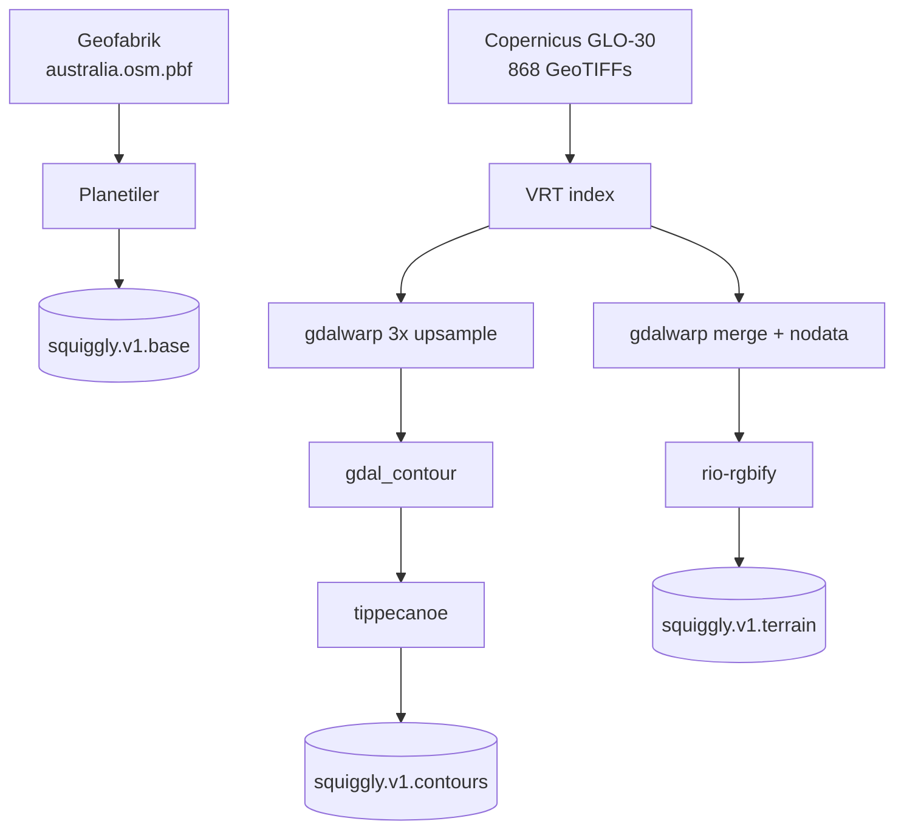

---
tags:
  - architecture
  - generation
  - pipeline
  - dem
  - terrain
aliases:
  - Pipelines
  - Tile generation
related:
  - "[[SERVING]]"
  - "[[CACHING]]"
  - "[[GLOSSARY]]"
  - "[[scripts/SCRIPTS]]"
  - "[[TODO]]"
updated: 2026-10-22
---

# Generation

How source data becomes the three PMTiles archives, and why each pipeline is
shaped the way it is. The operational how-to — what to run, in what order — is in
[[README]]; this covers the decisions behind it. Serving the result is
[[SERVING]], and terms are in [[GLOSSARY]].

---

## Shape of the thing

Three independent pipelines producing three archives. Two of them share a source.



The OSM pipeline is one tool and one step. Both DEM pipelines read the same 868
tiles and diverge only in what they extract: discrete labelled lines for
contours, a continuous encoded surface for terrain.

Nothing is incremental. Each pipeline rebuilds its archive from scratch, so the
practical unit of work is "regenerate a whole layer".

---

## Source data

| Dataset | Extent | On disk | Licence |
|---|---|---|---|
| OSM Australia (Geofabrik) | national extract | ~2 GB | ODbL — attribution required |
| Copernicus GLO-30 DEM | 112°–154°E, 44°–10°S | **27 GB, 868 tiles** | Copernicus — attribution required |
| Natural Earth | global | fetched by Planetiler `--download` | public domain |

The DEM bounding box is a 34 × 42 grid, so 1,428 tiles are possible; 868 exist
because the rest are open ocean and Copernicus doesn't publish empty tiles. Each
is a 1°×1° GeoTIFF of elevation in metres at 30 m resolution.

No AWS account is needed — `s3://copernicus-dem-30m` is public and the script
uses `--no-sign-request`, downloading 10 tiles in parallel via `xargs -P`.

---

## The VRT layer

`gdalbuildvrt` produces an XML index that makes N GeoTIFFs look like one seamless
raster to every downstream GDAL tool. No pixel data is copied, so building it is
seconds and costs kilobytes.

The paths inside the VRT are **container paths** (`/data/datasets/...`), not host
paths. The VRT is only ever read from inside the `gdal` container, and this is
the reason it can't be used from the host without rewriting.

### The two VRTs are now the same file in all but name

`build-vrts.sh` produces both `australia-dem.vrt` (contours) and
`australia-terrain.vrt` (terrain). They were meaningfully different when terrain
covered only the Snowy Mountains and a 400 km radius around Manilla, NSW — about
90 tiles against the full set.

Terrain has since been expanded to all of Australia, using the same bounding box
as the DEM download. **Both VRTs now index the identical 868 tiles.** The split
is vestigial: it costs nothing but implies a distinction that no longer exists.
Worth either collapsing to one VRT or re-narrowing terrain, rather than leaving a
reader to infer a difference that isn't there.

> [!warning] The config was expanded; the archive wasn't
> The terrain archive in `tiles/` predates the change. Its intermediate MBTiles
> covers only about 146–154°E, 27–37°S — 16,805 tiles, the Eastern Seaboard
> benchmark run — while `datasets/tmp/australia-dem-clean.tif` (27 March) is a
> full-Australia merge that was never encoded. Checked 2026-10-22 against
> `datasets/tmp/australia-terrain.mbtiles` and the archive header; the R2 copy
> was not checked but is presumably the same file.

---

## Pipeline 1 — OSM base map

```
australia.osm.pbf → Planetiler → squiggly.v1.base.pmtiles
```

One tool, one step, PMTiles written directly — no MBTiles intermediate, unlike
the other two.

Planetiler implements the [OpenMapTiles](https://openmaptiles.org/schema/)
schema: it sorts raw OSM features into 16 thematic layers, simplifies geometry
per zoom level, and drops features below zoom-appropriate thresholds. Choosing a
published schema rather than a bespoke one is what lets off-the-shelf styles work
against these tiles, and why `styles/` can be edited in Maputnik.

`--download` fetches the auxiliary datasets Planetiler needs (Natural Earth for
low-zoom land polygons, lake centrelines) on first run.

Test mode passes `--bounds` to clip to the Bright tile rather than using a
separate input file.

Output: z0–14, 16 layers, attribution baked into the archive metadata.

---

## Pipeline 2 — Contours

```
868 GeoTIFFs → VRT → gdalwarp 3x upsample (per tile, 8 parallel)
             → gdal_contour (per tile) → GeoJSON
             → tippecanoe → MBTiles → pmtiles convert
```

### Why upsample before tracing

`gdal_contour` walks the raster grid, so at native 30 m resolution the traced
lines inherit the grid and come out visibly stepped. Resampling 3× with cubic
spline (`-tr 0.000277778`, ≈10 m) before tracing gives the tracer a smoother
surface and the lines follow the terrain rather than the pixels.

This is interpolation, not new information — it buys visual quality, not
accuracy. Resampling elevation is safe here in a way it explicitly is not for
terrain (see [[#Why rio-rgbify, despite being the slowest correct option|Pipeline 3]]).

### Why per-tile, and why 8 at a time

Each of the 868 tiles is upsampled and traced independently, 8 containers at a
time via `xargs -P`. Per-tile work is what makes the parallelism possible at all,
and it makes the step **resumable** — both stages skip tiles whose output already
exists, so an interrupted run picks up where it stopped rather than restarting.

Tippecanoe then merges every GeoJSON at once, which is where cross-tile
consistency is recovered.

### Parameters

| Setting | Value | Why |
|---|---|---|
| Contour interval | 20 m | Fine enough for terrain reading, coarse enough to stay legible |
| Zoom range | 8–14 | Below z8 contours are unreadable; z14 matches the base map |
| `--simplification` | 4 | Douglas-Peucker tolerance; higher loses switchbacks |
| `--detect-shared-borders` | on | Keeps adjacent lines from separating under simplification |
| `--no-feature-limit`, `--no-tile-size-limit` | on | Dense alpine tiles legitimately exceed tippecanoe's defaults; dropping features would leave holes |

Output attributes are `elevation` (metres) and `ID` (a gdal_contour serial).

> [!note] There is no `is_major` attribute.
> `MAJOR_INTERVAL=100` exists in the script, but `gdal_contour` is only ever passed `-a elevation`, so nothing
> generates a major/minor flag. Confirmed against the published TileJSON — the
> layer's fields are `ID` and `elevation`. The script used to advertise
> `is_major` in its output; that message has been corrected. Style index
> contours with a modulo expression instead:
> `["==", ["%", ["get", "elevation"], 100], 0]`.

---

## Pipeline 3 — Terrain

```
868 GeoTIFFs → VRT → gdalwarp merge + nodata→0 → single GeoTIFF
             → rio-rgbify (terrarium) → MBTiles → pmtiles convert
```

### Why a merged GeoTIFF first

`rio-rgbify` does not respect GDAL nodata masks. Fed the VRT directly, the gaps
between tiles read as garbage floats and crash the encoder. `gdalwarp` merges
everything into one DEFLATE-compressed, tiled, BIGTIFF GeoTIFF with
`-dstnodata 0`, which flattens gaps to sea level. Costs about 73 s and makes the
rest of the pipeline possible.

### Terrarium encoding

Elevation is packed into the RGB channels of an ordinary PNG:

```
elevation = (R × 256 + G + B ÷ 256) − 32768
```

rio-rgbify parameterises this as `base_val + (R×65536 + G×256 + B) × interval`,
hence the `--base-val -32768 --interval 0.00390625` (1/256) in the script.

Nobody views the image. MapLibre's `raster-dem` source decodes it back to heights
for hillshade and 3D terrain.

### Why rio-rgbify, despite being the slowest correct option

This was benchmarked properly (March 2026, Eastern Seaboard subset, 69 DEM tiles,
z0–12, 16,805 tiles). The constraint that decides it:

> [!important] Terrarium is a base-256 number, so resampling the encoded RGB breaks it.
> Averaging R, G and B independently is meaningless at every 256 m boundary where
> G wraps 255→0 and R increments. The carry relationship is destroyed and the
> error reaches 128 m — visible as spikes along contour lines. The only correct
> order is resample the raw elevation, *then* encode per pixel.

| Approach | Time | Output | Verdict |
|---|---:|---:|---|
| **rio-rgbify (single, 10 workers)** | **1320 s** | 4.9 G | **Correct** — resamples then encodes |
| GDAL from terrarium VRT (bilinear) | 1027 s | 4.5 G | Broken — artifacts at 256 m boundaries |
| GDAL from terrarium VRT (nearest) | 151 s | 2.9 G | No artifacts, unacceptable aliasing |
| Custom Python tiler | 397 s | 4.8 G | Tile-boundary seams; 4 iterations, abandoned |
| rio-rgbify, zoom split 3 ways | 2244 s | 4.9 G | Correct but 1.7× slower |
| rio-rgbify, zoom split 6 ways | 21953 s | 4.9 G | 16.6× slower |

Two conclusions worth keeping:

- **gdal2tiles cannot do this at all** — it has no plugin point between resample
  and write, so it can only resample already-encoded values.
- **Splitting rio-rgbify across zoom levels makes it dramatically worse.** Each
  process re-reads the entire GeoTIFF, thrashing I/O and memory. Its internal
  `-j` workers are far more efficient than external parallelism. This is the
  opposite of the contour pipeline, where per-tile parallelism is the whole
  trick — the difference is that contour work partitions cleanly and terrain
  encoding does not.

The bottleneck is entirely tile encoding and PNG writing, not the warp.

> [!note] Worker count
> The benchmark ran 10 workers, but until October 2026 the script never passed
> `-j`, so real builds ran at rio-rgbify's default of 4. It now passes one worker
> per CPU Docker has (`RGBIFY_WORKERS=N` overrides).

Output: z0–12 (~38 m/pixel at z12, roughly matching the 30 m source).

> [!warning] Terrain metadata is wrong and it isn't cosmetic.
> The archive declares global bounds (`-180,-85 → 180,85`) when it covers Australia, carries an empty
> `name`, and has **no `attribution`** — despite Copernicus requiring attribution.
> Contours get theirs from tippecanoe's `--attribution` flag; rio-rgbify has no
> equivalent, so nothing sets it. Clients that render attribution automatically
> from TileJSON will show nothing for terrain.
>
> **Fixed in the script, October 2026:** `generate-terrain-tiles.sh` writes name,
> attribution and the merged GeoTIFF's extent into the MBTiles metadata table,
> and `pmtiles convert` carries them into the header and JSON metadata. Archives
> built before that still have the problem until regenerated.

---

## Test mode

Every generation script takes `--test`, which swaps in a single 1°×1° DEM tile
covering Bright, Victoria (`S37/E146` — alpine terrain, good paragliding, plenty
of relief to check contours against). Outputs are suffixed `-test` and appear as
separate toggleable layers in the preview page.

This turns hours into minutes and is the only sane way to iterate on pipeline
parameters. It is also what the worker's test suite runs against — the `-test`
archives are real PMTiles files, so parsing, directory traversal and the
`EtagMismatch` retry are genuinely exercised (see [[worker/README|worker/README.md]]).

The one thing test archives cannot reproduce: they are small enough to upload to
R2 in a single part, so they get plain MD5 ETags. Production archives are
multipart and get the `<hash>-<parts>` form, which is what version codes are
derived from.

---

## Regeneration cost

| Pipeline | Rough cost | Trigger |
|---|---|---|
| OSM base | tens of minutes | New Geofabrik extract, schema change |
| Contours | hours (868 tiles × 2 GDAL passes) | New DEM, interval or zoom change |
| Terrain | hours, encoding-bound | New DEM, zoom change |

All three are resumable only to the extent noted above — contours skip completed
tiles, the other two restart. Re-running any pipeline changes the archive bytes,
hence its R2 ETag, hence every tile URL it serves; see [[CACHING#Versioning and redeploys]].

---

## Known gaps

Collected from the walkthrough above, in rough order of how much they matter:

1. **Terrain covers only the Eastern Seaboard** — the full-Australia build was
   configured but never run. See [[#The two VRTs are now the same file in all but name]].
2. **Terrain has no attribution and wrong bounds** — a licence-compliance issue,
   not just untidy metadata. Fixed in the script; takes effect on the next build.
3. **The two VRTs are identical** — a distinction that no longer exists. Collapse
   to one, or re-narrow terrain.
4. **No incremental regeneration** — a one-tile DEM update rebuilds everything.

Two others found in this pass have been fixed: the contour script advertised an
`is_major` attribute it never generated, and `init.sh` pointed at a
`generate.sh` that does not exist.
