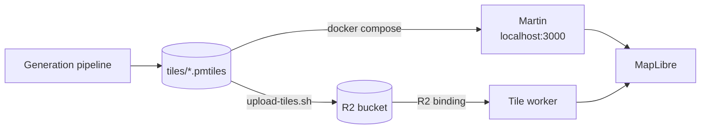

---
tags:
  - architecture
  - serving
  - worker
  - pmtiles
aliases:
  - Tile serving
  - Request path
related:
  - "[[CACHING]]"
  - "[[GENERATION]]"
  - "[[GLOSSARY]]"
  - "[[worker/README]]"
updated: 2026-10-23
---

# Serving

How a map tile gets from a generated archive to a pixel on screen. Covers the
data path and the URL scheme; the cache layers along that path are in
[[CACHING]], and how the archives are built in [[GENERATION]]. Terms are in
[[GLOSSARY]].

---

## Two serving paths

The same archives are served two different ways depending on where you are.



| | Local | Production |
|---|---|---|
| Server | Martin (`docker compose`) | Cloudflare Worker (`worker/`) |
| Storage | `tiles/` on disk | R2 bucket `squiggly-maps-v1` |
| Host | `localhost:3000` | `maps.tweed.nz` (intended — today only `dev.tweed.nz` runs the worker) |
| Source of truth for a source ID | filename | R2 object key |

Martin auto-discovers any `.pmtiles` or `.mbtiles` file in `tiles/` and uses the
filename (minus extension) as the source ID. The worker does the same with R2
object keys. So `squiggly.v1.base` names the same thing in both, and a style can
be pointed at either by changing only the host.

The two are **not** interchangeable in one respect: Martin serves TileJSON at
`/{source}` and tiles at `/{source}/{z}/{x}/{y}`, with no version segment. The
worker adds one. See [[#URL schemes]].

---

## The archives

Three archives, generated by the scripts in `scripts/`, each a single PMTiles
file. All three are regenerable from source data and none are in git.

| Archive | Contents | Tile format | MapLibre source type |
|---|---|---|---|
| `squiggly.v1.base` | OSM base map, OpenMapTiles schema | MVT (vector) | `vector` |
| `squiggly.v1.contours` | 20 m contour lines, `elevation` attribute | MVT (vector) | `vector` |
| `squiggly.v1.terrain` | Copernicus DEM, terrarium-encoded | PNG (raster) | `raster-dem` |

Each has a `-test` counterpart covering a single small area, used by the worker's
test suite and for fast local iteration.

### Two independent notions of "version"

The `v1` in the filename and the version segment in a tile URL are unrelated,
and conflating them causes confusion:

- **`v1`** is a hand-managed *schema* version, baked into the filename by the
  generation scripts. Bump it when the tile schema changes such that existing
  styles would break — new layers, renamed attributes. A deliberate decision.
- **The URL version segment** is a content hash derived automatically from the
  archive's R2 ETag. It changes on every re-upload, including one that just
  refreshes the same schema with newer OSM data.

So `squiggly.v1.base` at two different version codes is the same schema with
different data, and a style written against `v1` works with both.

### Why base and contours are vector, terrain is raster

**Overzoom** is the decisive reason for vector. The vector archives stop at
their maxzoom (z14 for base) and MapLibre renders them at any zoom above that —
geometry is resolution-independent. Raster can't: it needs real tiles at every
zoom, and z14 → z18 is 4⁴ = 256× more tiles.

Vector also buys restyling without regeneration (two styles read the same
1.2 GB archive), dynamic label placement along contour lines from the
`elevation` attribute, labels that stay upright as the map rotates, and DPI
independence.

Terrain is raster because it isn't geometry — it's a continuous elevation field,
one value per pixel. The terrarium encoding packs height into the colour
channels:

```
elevation = (R * 65536 + G * 256 + B) * interval + base_val
```

Nobody looks at the image. MapLibre's `raster-dem` source decodes those bytes
back into heights for the hillshade layer and 3D terrain. Encoding it as PNG is
what lets it ride the same tile infrastructure as everything else.

Contours and terrain come from the same Copernicus DEM, extracted two ways — one
wants discrete labelled lines, the other a continuous surface.

---

## How PMTiles resolves a tile

A PMTiles archive is a single file laid out so any tile can be found with a few
byte-range reads, without an index server:

```
┌────────┬───────────────┬──────────┬─────────────────┬──────────────┐
│ header │ root directory│ metadata │ leaf directories│  tile data   │
└────────┴───────────────┴──────────┴─────────────────┴──────────────┘
```

Resolving `z/x/y`:

1. **Header** (127 bytes; readers fetch the first 16 KB, which usually takes in
   the root directory too) — magic number, tile type, zoom range, bounds, and
   the offsets of every other section.
2. **Root directory** — maps tile IDs to either a tile's `(offset, length)` or a
   leaf directory to descend into. Tiles are ordered along a Hilbert curve, so
   spatially adjacent tiles are adjacent in the file.
3. **Leaf directory** (large archives only) — same structure, one level down.
4. **Tile data** — the MVT or PNG bytes.

Cold, that's three or four reads. Once the header and directories are cached the
worker needs a single read per tile — which is why `ArchiveStore` keeps them in
an isolate-level cache (see [[CACHING#Layer 3 — Worker isolate memory|CACHING, layer 3]]).

**This structure is what made direct R2 serving attractive and then failed.**
The format is designed to be read over HTTP Range requests straight from object
storage, which is exactly what the old `pmtiles://` setup did. It fell over on
cache behaviour, not on the format — see [[CACHING#Why the old design failed]].

---

## URL schemes

### Production (worker)

| Route | Returns |
|---|---|
| `GET /` | JSON index of servable archives |
| `GET /{archive}.json` | TileJSON — the indirection point |
| `GET /{archive}/{version}/{z}/{x}/{y}.{ext}` | One tile, `immutable` |
| `GET /{archive}/{z}/{x}/{y}.{ext}` | Unversioned; served, briefly cacheable |

```
https://maps.tweed.nz/squiggly.v1.base/f1c266e469/8/234/151.mvt
                      └─ archive ────┘ └ version┘ └ z/x/y ┘└ext┘
```

`{ext}` must match the archive's declared tile type — `.mvt` for the vector
archives, `.png` for terrain. A mismatch is a 404 rather than a guess, because
the archive header is the authority on what it contains.

### Local (Martin)

| Route | Returns |
|---|---|
| `GET /catalog` | All discovered sources |
| `GET /{source}` | TileJSON |
| `GET /{source}/{z}/{x}/{y}` | One tile |

No version segment and no extension. Martin serves from disk, so there is no
re-upload to invalidate against.

---

## The request path

What happens when MapLibre needs a tile in production:

1. **Style load.** The style's `sources` block names a TileJSON URL per source.
   MapLibre fetches each one **once**, at style load — it does not poll them and
   does not refetch on a failed tile.
2. **TileJSON.** The worker HEADs the R2 object for its ETag, reads the archive
   header and metadata, and returns a document whose `tiles` template carries
   the current version code, plus zoom range, bounds and `vector_layers`.
3. **Tile requests.** MapLibre substitutes `{z}/{x}/{y}` into that template and
   requests tiles as the viewport demands — commonly tens to low hundreds per
   map load.
4. **Worker resolves the tile.** Checks the allowlist, parses the path, opens
   the archive through the R2 binding, walks header → directories → tile data,
   and returns the bytes uncompressed — see Compression below.
5. **Absent tiles return 204**, not 404. An empty area of the archive is a
   normal, cacheable answer.

Because TileJSON is fetched once per map load and tiles are fetched continuously
against the template it handed out, **TileJSON is where a redeploy takes effect**
— that indirection is the whole reason the version segment works.
[[CACHING#What happens to a client mid-redeploy|CACHING]] covers the timing.

---

## How a style consumes it

`styles/squiggly-outdoor.json` declares four sources across three archives:

```json
"sources": {
  "base":      { "type": "vector",     "url": ".../squiggly.v1.base.json" },
  "contours":  { "type": "vector",     "url": ".../squiggly.v1.contours.json" },
  "hillshade": { "type": "raster-dem", "url": ".../squiggly.v1.terrain.json" },
  "terrain":   { "type": "raster-dem", "url": ".../squiggly.v1.terrain.json" }
}
```

Terrain appears twice deliberately: once feeding the `hillshade` layer (shaded
relief drawn into the map) and once feeding the top-level `terrain` block (3D
elevation of the whole scene). Same archive, two consumers.

`upload-style.sh` rewrites the host in these URLs to `R2_PUBLIC_URL` on upload,
so the same style file serves dev and production. It can't serve local Martin,
whose URLs have a different shape, shown next. The preview's Stylesheets options
load the files unrewritten, pointing at `maps.tweed.nz`, so they show no squiggly
tiles until that host moves to the worker.

Against local Martin the same pattern takes XYZ URLs directly, since Martin has
no version segment:

```js
const demOpts = {
  type: 'raster-dem',
  tiles: ['http://localhost:3000/squiggly.v1.terrain/{z}/{x}/{y}'],
  encoding: 'terrarium',
  tileSize: 512
};

map.addSource('terrain-hillshade', demOpts);
map.addLayer({ id: 'hillshade', type: 'hillshade', source: 'terrain-hillshade' });

map.addSource('terrain-3d', demOpts);
map.setTerrain({ source: 'terrain-3d', exaggeration: 1.5 });
```

---

## Serving locally against a deployed worker

The preview page reads its tile host from `R2_PUBLIC_URL`, so a locally served
MapLibre can point at any deployed worker:

```bash
R2_PUBLIC_URL=https://dev.tweed.nz ./scripts/preview.sh
```

This is the highest-fidelity test short of production — a real browser, real
concurrency, real CORS, real archives — and the only one that exercises MapLibre
actually rendering. Two caveats:

- **Edge caching works here** ([[CACHING#Layer 2 — The Cloudflare edge|CACHING, layer 2]]), so a second pan over the
  same area is served from cache rather than R2.
- **CORS** is handled by the worker's `CORS_ORIGIN` var, `*` by default.

---

## Compression

**The worker serves tile bytes uncompressed and lets the edge handle encoding.**

It used to gzip vector tiles itself and set `Content-Encoding: gzip`. That is
broken on Cloudflare: the platform strips a manually-set `Content-Encoding` from
a Worker response while leaving the body encoded, so clients receive gzip bytes
labelled `application/vnd.mapbox-vector-tile` and MapLibre's protobuf parser
fails on them. Observed on both the cache-miss and cache-hit paths, and for
every `Accept-Encoding` value including `identity`.

Two consequences worth knowing:

- **Cloudflare is not currently compressing MVT on the way out either.** `.mvt`
  is not in its default auto-compress set, so tiles go over the wire as raw
  protobuf. Measured cost on real tiles is **~1.4–1.6× larger** than gzip —
  smaller than it sounds, because tippecanoe has already simplified the
  geometry. A Compression Rule in the dashboard matching
  `application/vnd.mapbox-vector-tile` would recover it if the bandwidth
  matters.
- **PNG terrain tiles are unaffected** — they were never compressed by the
  worker and are already compressed as a format.

The rule generalises: don't set `Content-Encoding` on a Worker response. There
is a regression test asserting tile bodies carry no gzip magic
(`tile-service.test.ts`).

---

## Assumptions

**Martin and the worker agree on source naming.** Both derive the source ID from
the filename/key minus `.pmtiles`. Nothing enforces this — it is a convention the
generation scripts and `upload-tiles.sh` happen to preserve. Renaming an archive
on upload would silently break the correspondence.

**The archive header is authoritative for tile type and zoom range.** The worker
trusts `header.tileType` and `header.minZoom`/`maxZoom` rather than any
configuration, so a regenerated archive that changes format needs no worker
change — but a style referencing the old extension would start 404ing.

**One archive per source.** There is no sharding or multi-file source. An
archive that outgrows what a single R2 object can serve comfortably would need
a different design, not a bigger file.
